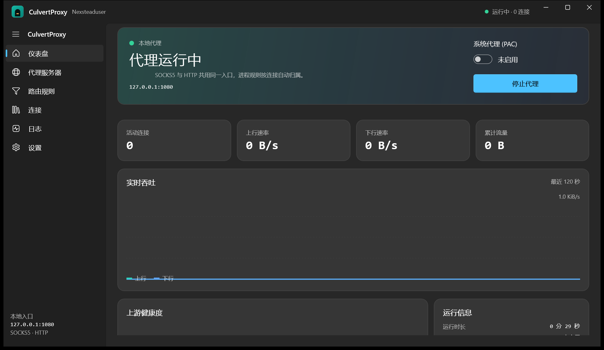

# CulvertProxy

[](https://github.com/Tinmc189623/CulvertProxy/actions)
[](https://tinmc189623.github.io/CulvertProxy/)
[](https://github.com/Tinmc189623/CulvertProxy/wiki)
[](https://github.com/Tinmc189623/CulvertProxy/releases/latest)
[](LICENSE)
[](SECURITY.md)
[](https://dotnet.microsoft.com/)
[](https://www.microsoft.com/windows/windows-11)

Windows 11 上的进程级代理客户端，对标 Proxifier：给应用透明套上 SOCKS5 / HTTP 链路，按进程、域名、IP、端口分流，同时兼顾高审查网络下的 DNS 泄漏与链路伪装。

WinUI3 界面，.NET 11，x64 原生 Winsock 注入，无内核驱动。



Copyright © 2026 Nexsteaduser. All Rights Reserved.

---

## 下载

到 [Releases](https://github.com/Tinmc189623/CulvertProxy/releases/latest) 下载：

- `CulvertProxy-win-x64.zip`：自包含便携包，解压后直接运行 `CulvertProxy.exe`
- `CulvertProxy-1.0.1-x64.msi`：按用户安装到 `%LOCALAPPDATA%\Programs\Nexsteaduser\CulvertProxy`，创建开始菜单快捷方式
- `CulvertProxy-1.0.1-x64.msix`：MSIX 安装包，需要先信任随包的签名证书

包内是自包含发布，不需要预装 .NET 或 Windows App SDK；`cli\culvert.exe` 是无界面 CLI。

### 运行要求

- Windows 11 24H2（build 26100）或更高，x64
- 接管高完整性进程时以管理员身份运行
- 发行包使用自签名开发证书签名，不是公共 CA 证书。MSI 会提示未知发布者；MSIX 需要先把 `Nexsteaduser-CulvertProxy-Signing.cer` 放入当前用户的「受信任的根证书颁发机构」或「受信任人」存储。正式分发请换成 CA 代码签名证书后重签

---

## 能做什么

- **进程级透明接管**：向当前用户的 x64 进程注入 `CulvertHook.dll`，拦截 `getaddrinfo`、`GetAddrInfoW`、`connect`、`WSAConnect`、`ConnectEx`、`WSAIoctl`、`sendto`、`WSASendTo`，把目标交给本地路由。应用本身不需要填写代理，.NET 的异步 Socket 与 `AF_INET6` 套接字也在覆盖范围内。
- **双入口**：SOCKS5 与 HTTP CONNECT 共用同一端口，自动识别；另带 SOCKS5 UDP ASSOCIATE 中继。
- **上游能力**：SOCKS5、HTTP CONNECT、多跳链、TLS 包装、独立 SNI、允许自签证书、叶证书 SHA-256 固定。
- **路由**：进程名/路径、域名通配符、IP CIDR、端口、TCP/UDP 维度；直连、代理、阻断三种动作。
- **策略调度**：故障转移、延迟优先、随机、按目标粘滞；连续失败熔断，握手延迟做 EWMA。
- **DNS**：系统解析或 DoH；DoH 可指定走代理；静态 hosts；本地 DNS 服务；fake-IP；拦截路径自带进程内 fake-IP，应用不向本地网络泄漏查询。注入层保留 `198.19.0.0/16`，引擎 fake-IP 默认使用不相交的 `198.18.0.0/16`，避免域名错配。
- **可观测性**：实时吞吐图、活动连接（含进程归属、规则、链路、字节数）、连接历史、可取消连接、分级日志。
- **系统集成**：PAC 系统代理、托盘、开机启动、关闭到托盘、深浅色主题。
- **配置向导**：首次启动引导选择透明接管、可选上游和 DNS；之后可从设置重新运行。
- **MCP 服务**：`cli\culvert.exe mcp` 通过 stdio 暴露本机控制工具，让 AI 客户端查询状态/连接/规则，并启动、停止、重载或测试链路。
- **CLI**：发行包内 `cli\culvert.exe run / resolve / check / mcp / version`，可无界面跑引擎。

---

## 快速开始

### 环境

- Windows 11 24H2（build 26100）或更高，x64
- .NET 11 SDK
- PowerShell 7
- 编译原生 Hook 需要 Visual Studio 2022 的「使用 C++ 的桌面开发」工作负载（MSVC 14.4x）与 Windows SDK 10.0.26100

WinUI3 与 Windows App SDK 走 NuGet，不需要单独安装 Windows App SDK 运行时（发布为自包含）。

### 构建

```powershell
pwsh -NoProfile -File .\build.ps1
```

发布包同时包含 WinUI 应用与 `culvert.exe` CLI。

构建 MSI 与 MSIX：

```powershell
dotnet tool install --global wix --version 5.0.2
pwsh -NoProfile -File .\build.ps1 -Publish
pwsh -NoProfile -File .\installer\build-packages.ps1 -CertThumbprint <证书指纹>
```

安装包脚本使用 Windows SDK 的 `makeappx.exe` 与 `signtool.exe`。传入 `-CertThumbprint` 时会签名便携包中的 exe/DLL、MSI 与 MSIX，并生成 SHA-256 校验文件。自签名证书只适合内部或受控分发；公共分发应使用 CA 代码签名证书。

构建顺序是：原生 `CulvertHook.dll` → .NET 解决方案 → 全套单元/集成测试。

发布自包含包：

```powershell
pwsh -NoProfile -File .\build.ps1 -Publish
```

产物在 `artifacts\publish\win-x64`，压缩包在 `artifacts\CulvertProxy-win-x64.zip`。

开发时也可以分步执行：

```powershell
pwsh -NoProfile -File .\native\build.ps1 -Configuration Debug -WithProbe
dotnet build CulvertProxy.sln -c Debug
dotnet run --project .\src\Nexsteaduser.CulvertProxy.App\Nexsteaduser.CulvertProxy.App.csproj
```

### 端到端冒烟

`tools\CulvertProxy.SmokeTest` 会启动回显服务、注入原生探针、验证 fake-IP 与接管链路，并且可以用 `.NET` 探针验证异步 `ConnectEx`：

```powershell
dotnet build .\tools\DotnetProbe\DotnetProbe.csproj -c Release
$probe = ".\tools\DotnetProbe\bin\Release\net11.0-windows10.0.26100.0\win-x64\DotnetProbe.exe"
dotnet run --project .\tools\CulvertProxy.SmokeTest\CulvertProxy.SmokeTest.csproj -c Release -- $probe
```

或者直接：

```powershell
pwsh -NoProfile -File .\build.ps1 -Smoke
```

输出 `SMOKE PASS` 与 `DOTNET PROBE PASS` 表示原生与 .NET 异步路径都已打通。冒烟会真实注入进程，请在受控环境运行。

---

## 使用流程

1. 首次启动会自动打开配置向导：选择是否启用透明接管，可填一个 SOCKS5 / HTTP 上游，再决定系统 DNS 或 DoH。找不到上游也可以直接完成，只使用本地入口。
2. 打开「代理服务器」，可以继续新增上游。协议选 SOCKS5 或 HTTP CONNECT；需要伪装时勾选 TLS 并填写 SNI，必要时填叶证书指纹。
3. 在「代理服务器」里建立策略。单服务器会自动生成默认策略；多服务器可以编排多跳链路，选择故障转移或延迟优先。
4. 「路由规则」按从上到下的顺序匹配。默认配置已把回环与内网做成直连规则。未命中走「默认策略」；没有默认策略时直连。
5. 启动代理。此时本地入口已可用，手动把 SOCKS5/HTTP 客户端指向 `127.0.0.1:1080` 即可。设置页的「配置向导」可以重新运行向导。
6. 需要接管桌面应用时，去「设置 → 透明接管」开启并保存。CulvertProxy 会注入当前用户的 64 位进程，并在之后约 1.2 秒的扫描周期内接管新进程。

### 系统代理与透明接管的区别

系统代理只影响读取 WinINET/PAC 的应用，浏览器、Electron 应用通常能吃上，游戏、命令行工具、自带网络栈的程序未必。透明接管从 Winsock 层拦截，覆盖面广得多。

两者可以同时开。应用连接 `127.0.0.1:<本地入口>` 时会走回环直连，不会再被接管一次。

### 透明接管的前提

- 只注入 x64 进程。32 位 WOW64 进程不注入。
- 只处理当前登录会话。会话 0 的系统服务不注入。
- 高完整性进程需要以管理员身份运行 CulvertProxy 才能注入。标准权限下这些进程会被跳过，日志里会写原因。
- 拦截的是 TCP，包含 `connect`、`WSAConnect` 与异步 `ConnectEx`。接管入口同时监听 `127.0.0.1` 与 `[::1]`，IPv6-only 套接字也有对应入口；IPv6 不可用时这类连接会失败关闭。
- UDP 不转发；发往 fake-IP 的 UDP/QUIC 会被拒绝，促使应用回落到 TCP。已经绕过 DNS、直接写死 IP 的 UDP 流量不在保护范围内。
- 新进程靠轮询发现，进程启动后到被注入之间可能存在短暂空窗。对时序极敏感的程序，可以先启动 CulvertProxy 并开启接管，再启动目标程序。
- 关闭接管或退出应用会写 `enabled=0`，已注入进程保留 DLL 并放行流量；已缓存的 fake-IP 会被还原成域名走真实 DNS 直连，不需要重启应用。进程退出后 DLL 自然卸载。
- 「入口不可用时回退直连」默认关闭。开启后引擎崩溃或端口不可达时，应用会直接连出去，真实地址会暴露。抗审查环境不要开。

被排除的进程：内置排除系统关键进程、浏览器外的 Shell 组件、杀毒软件、构建工具与 CulvertProxy 自身。用户还可以在设置里按进程名或完整路径写通配符，例如 `game.exe`、`D:\Tools\*.exe`。配置改动会实时写入 Hook，已注入的进程也会在下一次检查时放行。

---

## MCP 服务

先启动 `CulvertProxy.exe`，再让 MCP 客户端启动同一目录下的 CLI：

```powershell
# 安装 MSI 后的默认路径
claude mcp add culvertproxy -- "$env:LOCALAPPDATA\Programs\Nexsteaduser\CulvertProxy\cli\culvert.exe" mcp
```

其他 MCP 客户端使用 stdio 配置：命令填上面命令实际解析出的 `culvert.exe` 绝对路径，参数填 `mcp`。便携包指向解压目录下的 `cli\culvert.exe`。

可用工具：

- `culvert_status`、`culvert_get_config`
- `culvert_list_connections`、`culvert_list_endpoints`、`culvert_list_rules`、`culvert_list_policies`
- `culvert_start`、`culvert_stop`、`culvert_reload`
- `culvert_test_endpoint`、`culvert_kill_connection`

MCP 不监听网络端口。CLI 通过当前用户隔离的命名管道连接界面进程，密码与 `hook.conf` 令牌不会出现在工具结果里。界面进程未运行时，工具会返回明确的错误。

---

## 高审查网络下的部署建议

这部分是组合拳，单靠一个开关不够。

- **把上游藏进 TLS**：给 SOCKS5/HTTP 上游勾选 TLS，连接地址可以是 CDN 或中转 IP，SNI 单独填写一个正常站点。上游服务端需要在 TLS 之后讲 SOCKS5。
- **固定证书指纹**：填 64 位 SHA-256 叶证书指纹。比系统信任链更能抵抗企业代理或中间人替换证书。换证书时要同步更新。
- **DoH 走代理**：解析走的也是代理链路，本地 ISP 看不到查询内容。DoH 地址建议使用 IP，避免引导阶段的 DNS 依赖。
- **本地 DNS + fake-IP**：在设置里启用本地 DNS（默认 `127.0.0.1:5353`）和 fake-IP，把系统 DNS 指向它。这样使用 `GetAddrInfoExW` 或自带解析器的程序也会拿到 fake-IP，接管入口再还原成域名。Windows 设置里改 DNS 后记得在 DHCP 环境下恢复自动获取。
- **多跳与故障转移**：入口中转 → 出口落地，按延迟或顺序切换。链路上的每一跳都可以单独开 TLS。
- **失败关闭**：保持回退直连关闭。宁可断网，不要漏流量。
- **上游再套一层强伪装**：CulvertProxy 不实现 REALITY、uTLS、ECH、QUIC 或自定义多路复用。需要对抗主动探测时，把 sing-box、Xray 之类跑在本机或中转上，CulvertProxy 把它们的本地 SOCKS5 当作上游即可。分工是：强伪装隧道负责穿透，CulvertProxy 负责进程级分流与 DNS 收口。

详细威胁模型与配置取舍见 [docs/ANTI-CENSORSHIP.md](docs/ANTI-CENSORSHIP.md)。

---

## 架构

```text
应用进程                          CulvertProxy
┌──────────────┐   connect(目标)   ┌──────────────────────────────┐
│ getaddrinfo  │ ────────────────▶ │ CulvertHook.dll              │
│ 返回 fake-IP │                   │ 捕获目标 + PID + 随机令牌     │
└──────────────┘                   └──────────────┬───────────────┘
                                                   │ 127.0.0.1:随机端口
                                                   ▼
                                    ┌──────────────────────────────┐
                                    │ InterceptServer              │
                                    │ 校验 CPX1 前导 / 归属进程     │
                                    └──────────────┬───────────────┘
                                                   │
                        ┌──────────────────────────┼──────────────────────────┐
                        ▼                          ▼                          ▼
                  RuleEngine                  直连 / 阻断                TunnelFactory
                 进程/域名/IP/端口                                      SOCKS5 / HTTP / TLS
                                                                        多跳 / 健康度 / 失败切换
                                                   │
                                                   ▼
                                            远端目标 / 上游代理
```

普通 SOCKS5/HTTP 客户端走 `LocalProxyServer`，与接管入口共用同一套规则、链路、统计和连接表。DNS 侧由 `DohResolver` 统一处理静态 hosts、DoH、系统回退与缓存；本地 DNS 服务在此之上加 fake-IP。

更细的模块边界、前导协议字节布局与失效模式见 [docs/ARCHITECTURE.md](docs/ARCHITECTURE.md)。

---

## 项目结构

```text
src/Nexsteaduser.CulvertProxy.Core     引擎、协议、路由、DNS、注入、本地服务
src/Nexsteaduser.CulvertProxy.App      WinUI3 界面
src/Nexsteaduser.CulvertProxy.Cli      无界面命令行
tests/Nexsteaduser.CulvertProxy.Tests  单元与集成测试
tools/CulvertProxy.SmokeTest           端到端注入冒烟
native/src/CulvertHook.c               Winsock Hook
native/tools/probe.c                   原生诊断探针
native/third_party/minhook             MinHook 1.3.4（BSD-2-Clause）
```

配置文件与日志在 `%LOCALAPPDATA%\Nexsteaduser\CulvertProxy`。程序目录放一个 `portable.flag` 会切换到程序目录下的 `data` 便携模式；Hook 共享配置始终在 LocalAppData，保证注入进程能找到。

上游密码与本地入口密码用 DPAPI 当前用户范围加密后落盘。接管令牌每次启动重新生成，只存在于内存和受用户 ACL 保护的 `hook.conf` 中。接管入口只绑定 `127.0.0.1`，前导协议做固定时间令牌比较。

---

## 测试与质量

```powershell
dotnet test .\tests\Nexsteaduser.CulvertProxy.Tests\Nexsteaduser.CulvertProxy.Tests.csproj -c Release
```

覆盖 SOCKS5 认证与 CONNECT、UDP 关联、HTTP CONNECT 与绝对 URI 改写、多跳链路、HTTP 上游、静态 hosts、fake-IP 还原、规则匹配、前导协议、接管入口转发与错误令牌拒绝。端到端冒烟另外验证真实进程注入。

原生 Hook 单独构建，不参与 `dotnet test`；它的行为由冒烟工具覆盖。

仓库的质量门禁：

- GitHub Actions 在每次推送和 PR 上构建原生 Hook、运行完整解决方案与全部测试
- CodeQL 扫描 C# 代码，Dependabot 与 dependency-review 跟踪依赖变化
- `main` 禁止强制推送与删除，PR 合并要求 `windows` 检查通过且分支保持最新
- 安全问题按 [SECURITY.md](SECURITY.md) 私下报告

---

## 参与贡献

缺陷修复、测试、文档和经过验证的功能都欢迎提交。构建方式、分支约定、原生 Hook 的验证要求和安全报告渠道见 [CONTRIBUTING.md](CONTRIBUTING.md)，提交 PR 时请使用默认模板。

## 已知边界

- 没有内核驱动，因此没有系统级强制接管、UDP 重定向、进程创建前注入，也不需要驱动签名。换来的是部署简单、蓝屏风险低。
- x64 only。x86 进程不会被接管。
- 不实现抗主动探测的传输协议。TLS 包装和证书固定解决的是链路可见性与中间人，不是高级流量指纹。
- 没有服务模式。CulvertProxy 需要用户登录并运行；注销后引擎停止。
- 同一用户同一时间只允许一个引擎启用透明接管。第二个实例会拿到错误状态而不会改写 `hook.conf`，避免两套令牌互相覆盖。
- 当前发行包使用自签名开发证书。MSI 会显示未知发布者；MSIX 要求先把随包 `.cer` 放入受信任存储，或改用 CA 证书重签。未签名或不受信任的二进制也可能被 SmartScreen 或安全软件提示。
- 端口转发类程序、使用原始套接字或自带内核网络栈的软件可能绕过 Winsock Hook。

---

## 安全

漏洞报告渠道、支持版本、安全边界和加固建议见 [SECURITY.md](SECURITY.md)。不要在公开 Issue 中披露可利用漏洞、令牌或未脱敏日志。

## 合法使用

CulvertProxy 是网络调试与受控环境下的代理工具。请只在你有权管理的设备与网络上使用，并遵守所在地法律与服务条款。拦截与注入能力也可能被安全软件判定为敏感行为；分发前请完成签名与安全评审。

---

## 版权

Copyright © 2026 Nexsteaduser. All Rights Reserved.

第三方组件许可见 [THIRD-PARTY-NOTICES.md](THIRD-PARTY-NOTICES.md)。
